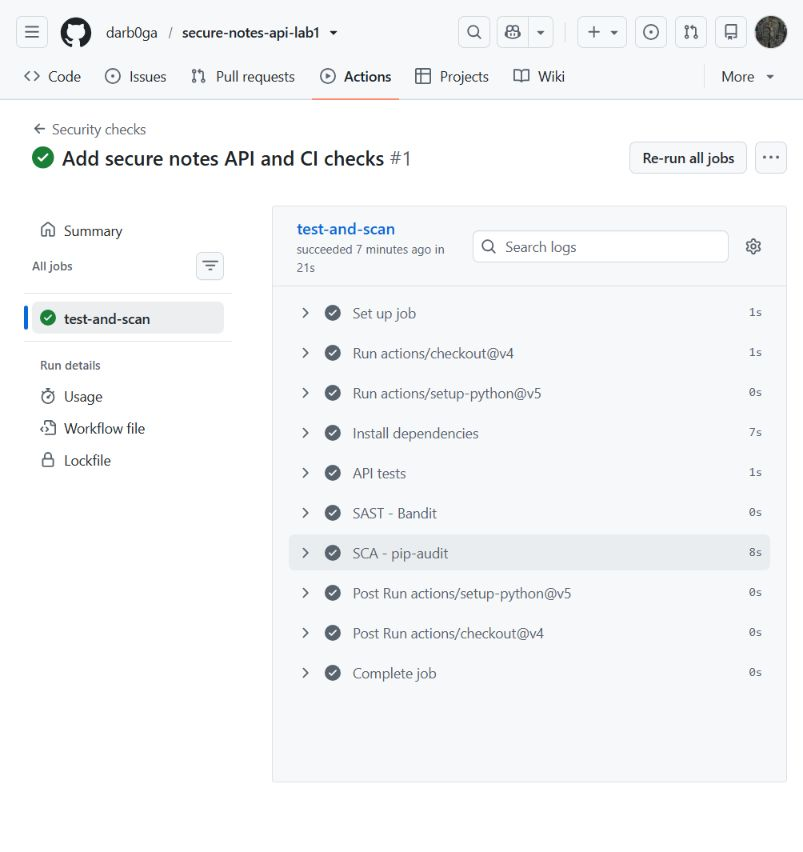
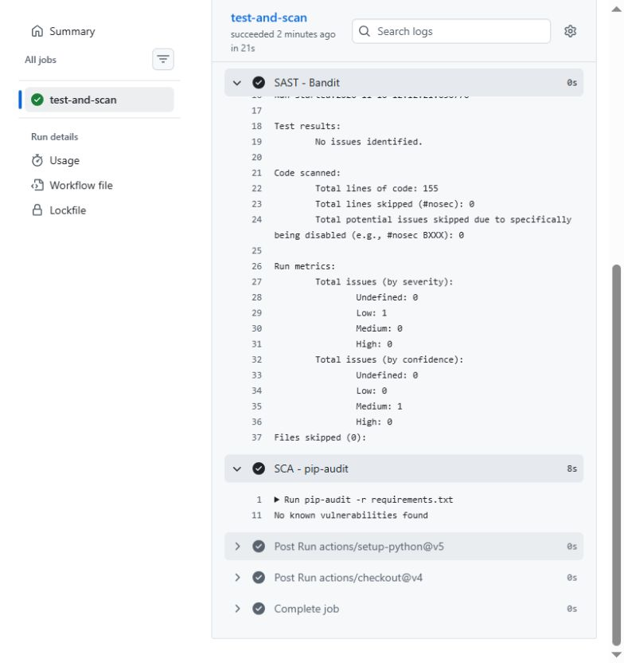

# Secure Notes API

Учебный REST API для лабораторной работы № 1 по информационной безопасности. Пользователь входит в систему и работает только со своими заметками. Данные хранятся в SQLite.

## Запуск

Нужен Python 3.11 или новее. В каталоге проекта:

```powershell
python -m venv .venv
.\.venv\Scripts\python.exe -m pip install -r requirements.txt
$env:JWT_SECRET = .\.venv\Scripts\python.exe -c "import secrets; print(secrets.token_hex(32))"
.\.venv\Scripts\python.exe create_user.py
.\.venv\Scripts\python.exe app.py
```

## API

| Метод | Путь | Назначение |
| --- | --- | --- |
| POST | `/auth/login` | Принимает JSON `{"username":"alice","password":"..."}` и возвращает JWT |
| GET | `/api/data` | Возвращает заметки текущего пользователя; нужен `Authorization: Bearer <token>` |
| POST | `/api/data` | Создаёт заметку из JSON `{"title":"...","body":"..."}`; нужен токен |

Пример запросов после создания пользователя:

```powershell
$login = Invoke-RestMethod -Method Post -Uri http://127.0.0.1:5000/auth/login -ContentType 'application/json' -Body '{"username":"alice","password":"ваш_пароль"}'
$headers = @{ Authorization = "Bearer $($login.access_token)" }
Invoke-RestMethod -Uri http://127.0.0.1:5000/api/data -Headers $headers
$noteJson = @{title='Первая заметка'; body='Учебный текст'} | ConvertTo-Json -Compress
$noteBytes = [System.Text.Encoding]::UTF8.GetBytes($noteJson)
Invoke-RestMethod -Method Post -Uri http://127.0.0.1:5000/api/data -Headers $headers -ContentType 'application/json; charset=utf-8' -Body $noteBytes
```

Без токена защищённые методы отвечают `401`. Для ошибочного логина или токена также возвращается `401`. Размер запроса ограничен 16 КБ, длина заголовка заметки — 200 символами, текста - 2000 символами.

## Меры защиты

- **SQL-инъекции:** все значения в запросах SQLite передаются через параметры `?`; текст пользователя не подставляется в SQL.
- **XSS:** пользовательские поля заметок экранируются через `html.escape` перед отправкой в JSON. Ответы имеют тип `application/json` и заголовок `X-Content-Type-Options: nosniff`.
- **Аутентификация:** пароли в базе хранятся только как хэши scrypt с солью. После успешного входа выдаётся JWT с `sub`, `iat`, `exp` и `iss`, действительный 30 минут. Декоратор проверяет подпись, срок действия, издателя и существование пользователя для каждого защищённого метода. Секрет берётся из переменной окружения и не хранится в репозитории.
- **Разграничение доступа:** выборка заметок фильтруется по `user_id` из проверенного токена.

Для реального публичного сервиса дополнительно потребуются HTTPS, ограничение частоты попыток входа, управление секретами и резервное копирование БД. Этот проект рассчитан на локальную учебную демонстрацию.

## Проверки

```powershell
.\.venv\Scripts\python.exe -m pip install -r requirements-dev.txt
.\.venv\Scripts\python.exe -m unittest discover -s tests -v
.\.venv\Scripts\bandit.exe -r app.py create_user.py -ll
.\.venv\Scripts\pip-audit.exe -r requirements.txt
```

GitHub Actions запускает тесты, SAST-анализ Bandit и два SCA-аудита при каждом push и pull request: OWASP Dependency-Check формирует HTML-отчёт по `requirements.txt`, а pip-audit дополнительно проверяет разрешённое дерево Python-зависимостей. Dependency-Check завершает проверку с ошибкой при CVSS 7 и выше. HTML-отчёт сохраняется как артефакт запуска в разделе **Actions**.


## Скриншоты проверок

 успешный запуск: [Security checks ]([https://github.com/darb0ga/secure-notes-api-lab1/actions/runs/43864411335](https://github.com/darb0ga/secure-notes-api-lab1/actions/runs/43924861584)).





Скриншоты выше относятся к первому запуску сканеров. Актуальные результаты с OWASP Dependency-Check находятся в запуске #5 и его HTML-отчёте по ссылкам выше.
